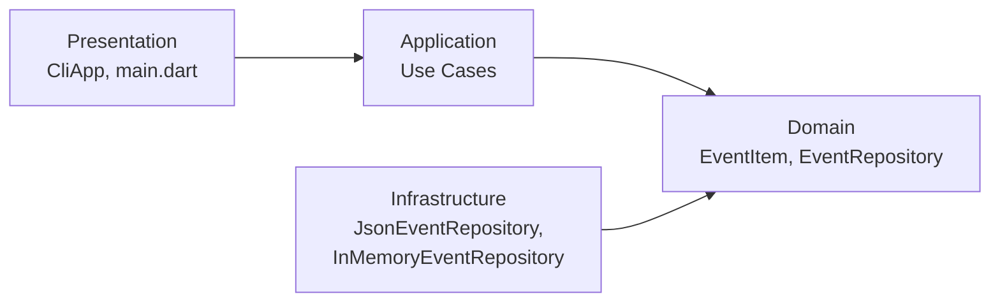

# Event Catalog

Каталог подій: консольний застосунок на Dart (Clean Architecture).

## Політика гілок

- `main` — стабільний код, лише релізи (теги `vX.Y.Z`)
- `develop` — інтеграційна гілка, сюди зливаються всі feature-гілки через pull request
- `feature/*` — гілки під конкретні задачі, створюються від `develop`

## Конвенція комітів

Використовуємо Conventional Commits: `feat`, `fix`, `refactor`, `docs`, `merge`.

Приклад: `feat(domain): додати сутність EventItem`

## Структура проєкту (Clean Architecture)

```text
bin/main.dart                      — точка входу
lib/domain/entities                — сутності
lib/domain/interfaces              — інтерфейси репозиторіїв
lib/application/use_cases          — сценарії використання
lib/infrastructure/repositories    — реалізації сховищ
lib/presentation/cli               — консольний інтерфейс
```

## Схема архітектури



Зовнішні шари залежать від внутрішніх: Presentation → Application → Domain ← Infrastructure.
Application працює лише з інтерфейсом `EventRepository`, а конкретний репозиторій
створюється в `bin/main.dart` і передається через конструктор (Dependency Inversion).

## Збірка і запуск

Потрібен Dart SDK 3.x.

```bash
dart pub get
dart analyze
dart run bin/main.dart
```

Сховище обирається у `config.json`: `"storage": "json"` (файл `filePath`)
або `"storage": "memory"` (дані в пам'яті).